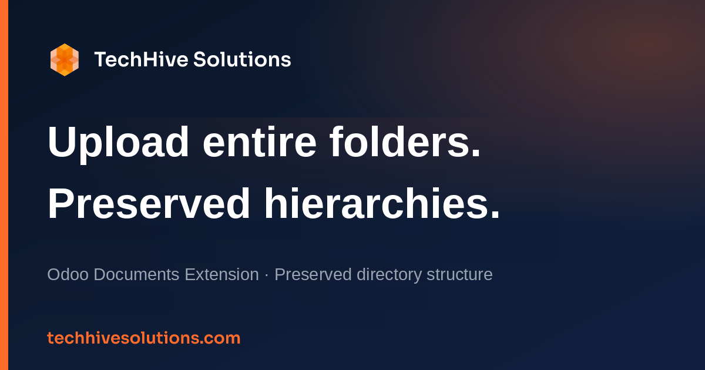
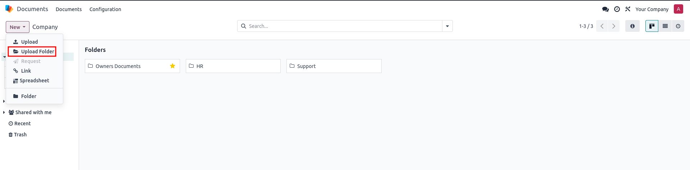

  

<h1 align="center">Documents Folder Upload</h1>

  Upload entire local directory structures directly into Odoo Documents — folder hierarchy preserved.

  
  
  

  <a href="https://apps.odoo.com/apps/modules/19.0/documents_upload_folder">
    <b>⬇&nbsp;&nbsp;Get it on Odoo Apps</b>
  </a>

---

## Overview

Recreate an entire local folder tree inside Odoo Documents in one action. Select a folder on your computer and the module rebuilds the exact nested structure as sub-workspaces, then uploads every file into place — no manual folder creation, no configuration.

The **Upload Folder** action sits right under the **New** button in Odoo Documents.

## Features

- 📁 **Preserves folder hierarchy** — scans your local directory and recreates the exact nested tree as sub-workspaces inside Odoo Documents.
- ⚡ **Seamless integration** — a clean, native "Upload Folder" button beside the default upload option. No extra menus.
- 🚀 **Bulk processing speed** — replaces hours of manual folder creation. Select one folder; Odoo builds the structure and uploads files instantly.
- 🔒 **Enterprise security** — built on Odoo's internal Documents API. Respects access rights, workspace permissions, and security settings.

## Screenshot

  

## Pricing & Versions

|                   |                                                                                      |
| ----------------- | ------------------------------------------------------------------------------------ |
| **Price**         | $35 USD                                                                              |
| **Odoo versions** | 18.0 · 19.0                                                                          |
| **License**       | OPL-1                                                                                |
| **Get it**        | [Odoo Apps listing](https://apps.odoo.com/apps/modules/19.0/documents_upload_folder) |

## Support

Built by **TechHive Solutions** — a certified Odoo Ready Partner and official Anthropic Claude Partner. We build AI integrations, ERP setups, custom Odoo plugins, and enterprise apps.

- 🌐 [techhivesolutions.com](https://techhivesolutions.com)
- ✉️ [info@techhivesolutions.com](mailto:info@techhivesolutions.com)

## License

The module is distributed under **OPL-1** via [Odoo Apps](https://apps.odoo.com/apps/modules/19.0/documents_upload_folder). Content in this repository © TechHive Solutions. Source code is not included here.
